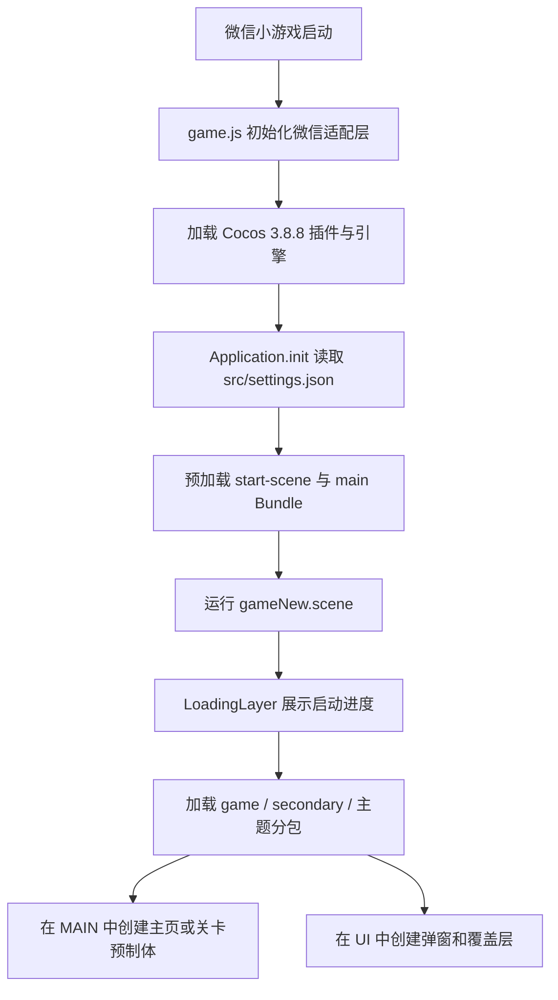
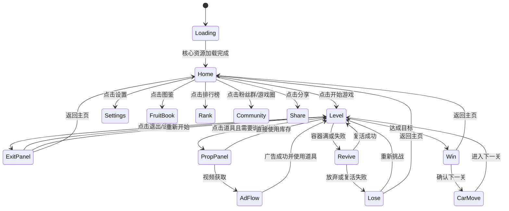

# 水果消除小游戏：玩法与运行逻辑还原说明

> 文档性质：基于微信小游戏发布包、Cocos 序列化场景/预制体、资源命名、物理配置、开放数据域代码和当前恢复工程的逆向分析文档  
> 分析源：`/Users/wangzidong/my_work/game_unpack/package/wxf41b76649658b9e3_unpacked`  
> 恢复工程：`/Users/wangzidong/my_work/test_game/shuiguo`  
> 分析日期：2026-10-16  
> 引擎版本：Cocos Creator 3.8.8  
> 文档版本：1.0

---

## 1. 文档目标与结论摘要

本文件用于指导从发布后的微信小游戏包中，尽可能还原原始 Cocos Creator 工程的页面结构、玩法规则、运行流程、物理交互、关卡系统、外围系统和脚本职责。

综合可读证据，该游戏是一款竖屏、关卡制、物理驱动的水果成对消除小游戏。核心关卡中，大量水果位于受墙体、障碍和机关约束的场地内，并可按关卡设定向左、向右或向下运动。玩家通过点击水果，使水果进入被点击/下落/收集状态；两个相同水果满足配对条件后消除。两个相同磁铁能够消除一组水果。玩家需要完成关卡规定的水果消除目标；当下方容器或可用槽位无法继续容纳水果时，触发“装不下啦”并进入失败/复活流程。

游戏并非使用多个 Cocos Scene 切换页面。发布包和当前恢复工程均只发现一个启动场景 `gameNew.scene`，主界面、关卡、排行榜、设置、图鉴、胜负、复活等内容均以预制体形式动态加载到常驻容器中。

目前可以高可信还原的部分包括：

- 单场景分层架构和主要页面流转。
- 成对水果消除、磁铁成对触发、装满失败、目标进度、复活、重新挑战和过关流程。
- 消除、刷新/打乱、消除多组、解锁槽位等道具入口。
- 墙体、普通障碍、木桩、冰块、洞口、绳/关节、闪电等关卡构件。
- 33 个水果玩法预制体、28 个蔬菜奖励预制体和 175 项图鉴容量。
- 1 至 1635 关的段位区间、世界榜/好友榜结构以及好友榜开放数据域实现。
- 音乐、音效、震动、分享、客服、游戏圈、玩家社区等外围功能入口。

目前不能从发布包直接恢复的部分包括：

- 主玩法 TypeScript/JavaScript 方法体、事件回调、状态机和算法实现。
- 精确的逐关配置、生成序列、数值曲线、目标数量和机关参数。
- 点击水果后的精确路径、速度、槽位分配和配对判定时机。
- 广告、远程配置、存档、统计上报和平台插件的业务接口细节。
- `animals`、`candies`、`seaAnimals`、`sweets` 四个声明过但未出现在当前解包目录中的主题分包内容。

因此，本文件既是玩法说明，也是后续工程还原的“证据清单 + 实现规格”。

---

## 2. 证据等级

为避免把资源命名推断误写为确定逻辑，本文使用以下标记：

| 标记 | 含义 | 使用条件 |
|---|---|---|
| **[A] 已确认** | 可直接从配置、可读代码、节点、标签、组件或音频名称确认 | 有至少一条直接证据 |
| **[B] 高可信还原** | 多项独立证据互相印证，足以作为第一版实现规格 | 节点、资源、物理结构、界面文案或截图中至少两项一致 |
| **[C] 推测** | 只有资源名、节点名或常见设计模式支持 | 实现前需要运行原包或抓取更多数据验证 |
| **[U] 未知** | 发布包缺少决定性业务代码或数据 | 不应擅自写死为原版规则 |

本文中不带标记的工程事实均按 **[A] 已确认** 处理。

---

## 3. 发布包与恢复工程概况

### 3.1 技术基础

| 项目 | 结论 |
|---|---|
| 引擎 | Cocos Creator 3.8.8 |
| 发布平台 | 微信小游戏 |
| 屏幕方向 | 竖屏 `portrait` |
| 设计分辨率 | 750 × 1334 |
| 屏幕策略 | `exactFitScreen: true`，策略值 4 |
| 启动场景 | `db://assets/res/scene/gameNew.scene` |
| 物理重力 | `(0, -10, 0)` |
| 物理步长 | 1/60 秒，即 `0.0166667` |
| 最大子步数 | 1 |
| 休眠 | 开启，阈值 0.1 |
| Cocos 微信插件 | 3.8.8，provider `wx0446ba2621dda60a` |
| 公共小游戏插件 | `MiniGameCommon`，provider `wxaed5ace05d92b218` |

### 3.2 包体可读性

发布目录约 21 MB。可读业务信息主要存在于：

- `src/settings.json`：启动场景、分包、分辨率、物理碰撞组。
- `assets/start-scene`：启动场景序列化数据和加载页资源。
- `subpackages/game`：主关卡预制体、UI、音效、机关和公共资源。
- `subpackages/secondary`：胜负、复活、排行榜、设置、图鉴等次级页面。
- `subpackages/fruits`：33 个水果物理预制体和水果图标。
- `subpackages/vegetable`：28 个蔬菜物理预制体和蔬菜图标。
- `subContext.js`：微信开放数据域的好友排行榜实现。
- `rangkingConfig.json`：段位与关卡区间映射。

发布包中的 `game.js` 主要是 Cocos 引擎、微信适配层、SystemJS 加载器和应用启动代码。四个现存分包的 `game.js` 均只有约 47 行，只注册空的 prerequisite 模块。除了开放数据域排行榜外，没有发现可读的主业务脚本模块。

这意味着原项目的组件类名和序列化字段仍保留在场景/预制体中，但组件方法体已经缺失或位于未取得的平台插件/外部代码中。

### 3.3 分包状态

`settings.json` 声明的工程 Bundle：

```text
internal
start-scene
main
animals
candies
fruits
game
seaAnimals
secondary
sweets
vegetable
```

实际解包目录中可见：

```text
internal
start-scene
main
fruits
game
secondary
vegetable
```

缺失但被配置声明的分包：

```text
animals
candies
seaAnimals
sweets
```

这四个名称与“图鉴总数 175”共同说明，原版很可能还包含动物、糖果、海洋动物、甜品等可切换主题或收集类别，但当前包体无法恢复其具体预制体和数值。该结论为 **[B]**。

### 3.4 当前恢复工程状态

`restore-report.json` 记录：

| 项目 | 数量 |
|---|---:|
| 已写入文件 | 930 |
| 从图集裁出的图片 | 14 |
| 跳过资源 | 115 |
| 跳过的引擎内置资源 | 31 |
| 缺少原生文件 | 0 |
| 恢复失败 | 0 |
| 恢复占位脚本 | 24 |

当前恢复工程可以在 Cocos Creator 3.8.8 中打开，Funplay Cocos MCP 已能读取编辑器状态和 `gameNew` 场景层级。24 个脚本目前只保留类 ID 和序列化属性，不包含原业务方法。

---

## 4. 运行架构

### 4.1 启动链路



启动类使用 `settingsPath = "src/settings.json"`，以 `DebugMode.ERROR` 初始化 Cocos，然后调用 `game.run()`。没有发现第二个场景的加载记录。

### 4.2 单场景容器结构

当前编辑器通过 MCP 回读到的有效游戏层级如下：

```text
gameNew
└─ Canvas
   ├─ Camera
   ├─ MAIN
   │  ├─ BG
   │  │  └─ bgshade
   │  ├─ Stage
   │  └─ NodeFps
   ├─ UI
   │  └─ LoadingLayer
   │     ├─ bg
   │     ├─ bgshade
   │     ├─ label [默认隐藏]
   │     ├─ bg_notice
   │     ├─ progress
   │     │  └─ loadbg
   │     │     ├─ loadfill
   │     │     └─ labPro
   │     └─ HUAWEI
   ├─ UIFade
   ├─ BlackInput
   ├─ GbzWaiting
   └─ MASK
```

容器职责：

| 节点 | 职责 |
|---|---|
| `MAIN/BG` | 全局背景和遮罩 |
| `MAIN/Stage` | 主页面、关卡主体的动态挂载点 **[B]** |
| `MAIN/NodeFps` | 帧率/调试节点 **[B]** |
| `UI` | 加载页、弹窗、排行榜、设置、胜负等 UI 的动态挂载点 **[B]** |
| `UIFade` | 页面淡入淡出过渡 **[B]** |
| `BlackInput` | 全屏输入阻断层 **[B]** |
| `GbzWaiting` | 等待/网络加载提示 **[B]** |
| `MASK` | 全局裁剪或覆盖遮罩 **[C]** |

### 4.3 页面不是独立 Scene

唯一 Scene 是 `gameNew`。以下“页面”均为 Prefab：

| 类别 | 预制体 | 作用 |
|---|---|---|
| 首页 | `GbzMenuLayer` | 开始游戏、当前关卡、设置、图鉴、排行、社区、客服、分享 |
| 关卡 HUD | `GbzMainLayer` | 退出、关卡提示、道具、方向变化、难度提示、调试入口 |
| 关卡主体 | `GbzLvCommon` | 水果、物理边界、目标、进度、障碍、机关、教程、满载提示 |
| 下落容器 | `GbzFruitDownLayer` | 点击水果后的下落/收集物理区 **[B]** |
| 退出设置 | `GbzExitLayer` | 音乐、音效、震动、退出/重开/继续 |
| 获得道具 | `GbzGetItemLayer` | 两类道具展示，视频获取或直接使用 |
| 特殊道具 | `GbzPropSpecialLayer` | 打乱、消除、消除多组、解锁槽位 |
| 失败 | `GbzLoseFullLayer` | 剩余目标、复活、挑战次数、重试、返回、分享 |
| 复活 | `GbzResurgenceLayer` | 剩余水果数、复活确认 |
| 胜利 | `GbzWin2Layer` | 胜利表现、进度、奖励、下一关/重开、分享 |
| 过关行驶 | `GbzCarMoveLayer` | 汽车从起点驶向终点的关卡过渡动画 |
| 图鉴 | `GbzFruitBookLayer` | 175 项收集进度和虚拟滚动列表 |
| 排行榜 | `GbzRankLayer` | 世界榜、好友榜、开放数据域 |
| 奖励领取 | `GbzGetRewLayer` | 领取奖励 |
| 设置 | `GbzSettingLayer` | 音乐、音效、震动、隐私政策/注销预留 |
| 玩家社区 | `GbzFansLayer` | 保存并扫描二维码加入社区 |

---

## 5. 产品页面流转



### 5.1 首页入口状态

`GbzMenuLayer` 中默认激活：

- 开始游戏，显示当前关卡数字。
- 设置。
- 粉丝群/玩家社区。
- 图鉴。
- 游戏圈。
- 客服。
- 排行榜。
- 分享。

默认隐藏或按平台/活动条件开启：

- 主题。
- 意见反馈。
- 订阅有奖。
- 添加桌面/添加有礼。
- 侧边栏相关入口。

这些入口是否显示，很可能由微信版本、渠道能力、活动开关或 `MiniGameCommon` 插件能力决定 **[B]**。

---

## 6. 核心玩法说明

### 6.1 一句话玩法

玩家在一个持续移动且受物理机关影响的水果场中点击水果，将水果投入下方收集区域；两个相同水果形成一对后消除，在容器装满前完成规定数量的消除即可过关。该描述的“点击投入”部分为 **[B]**，配对、移动、装满失败和目标数量为 **[A]**。

### 6.2 直接可见的规则文案

关卡预制体中保留两段新手引导：

```text
2个 相同 的水果会消除
2个 相同 的磁铁会消除 一组水果
```

还保留：

```text
水果从左往右移动
装不下啦
```

因此可以确认：

1. 基础匹配单位是两个，而不是三个。
2. 相同类型水果形成匹配后被消除。
3. 磁铁是场内特殊对象，两个相同磁铁形成匹配后执行范围更大的“一组水果”消除。
4. 水果存在自动移动方向，至少支持从左到右。
5. 场地存在容量上限，装不下时进入失败风险。

### 6.3 单局空间分层

```text
顶部/上方
├─ 关卡号与关卡提示
├─ 水果生成或进入区域
├─ 水果自动移动区
├─ 墙体、冰块、洞、木桩、障碍、关节等机关
└─ 目标水果/剩余数量/进度

中部
├─ 主水果物理场 fruits
├─ 可检测边界 canCheck
├─ 满载警戒线 boundaryLine
├─ 左右墙、掉落通道和底板
└─ 特效与命中反馈

底部
├─ basket01 / basket02 容器表现
├─ FruitDownLayer 下落物理层
├─ 消除道具
├─ 刷新/打乱道具
└─ 解锁槽位入口（条件出现）
```

资源中的排行榜背景图是原版界面的静态截图，可作为视觉参照：


注意：该图片是发布资源，不是当前恢复工程的运行截图。它能证明第 25 关界面、底部“消除”“刷新”和“解锁”入口的视觉关系，但不能证明所有按钮在每一关都常驻。

### 6.4 单局标准流程

1. **关卡初始化 [B]**
   - 读取当前关卡号与难度模式。
   - 选择主题背景、墙体皮肤和水果集合。
   - 创建物理边界、障碍、机关和目标水果。
   - 设置水果运动方向。
   - 初始化目标数量、剩余数量、进度、道具数量和可用槽位。

2. **水果运动 [A/B]**
   - 水果位于 `fruits` 容器中，使用 `RigidBody2D` 和多边形碰撞器。
   - 方向提示支持向左、向右、向下；资源中还存在“中间”“雪花”“黑洞”“未知”等机关提示图标。
   - “水果从左往右移动”是已确认的关卡提示；其他方向由 HUD 图标和提示节点支持。

3. **玩家操作 [B]**
   - 玩家点击可操作水果。
   - 点击音频为 `点击水果.mp3`，碰撞配置中存在 `clickFruit` 组。
   - 被点击水果很可能进入下落/收集状态，并移动至 `FruitDownLayer` 或底部容器。
   - 精确的点击合法性、轨迹和速度属于 **[U]**。

4. **落地与配对 [A/B]**
   - `FruitDownLayer` 具有左右墙和地板，说明选中水果会进入独立的物理落地区。
   - 音频包含 `水果喷射`、`水果落地`、`相同水果碰撞`、`水果消失`、`xiaochu_1..5`。
   - 两个相同水果满足配对条件后消除，并更新目标与进度。
   - 连续消除可能按 1 至 5 档播放不同消除音效 **[B]**。

5. **特殊对象触发 [A]**
   - 两个相同磁铁匹配时，消除一组水果。
   - 对应资源：`effMagnet.prefab`、`磁铁音效.mp3`。

6. **胜负判断 [A/B]**
   - 达成目标水果数量或完成目标进度时胜利。
   - 下落区/槽位达到容量上限时显示“装不下啦”，随后进入复活或失败。
   - 是否还存在超时失败取决于关卡类型；HUD 有默认隐藏的 `03:00` 计时器，但没有发现可读逻辑，故为 **[C]**。

7. **结算 [A]**
   - 胜利：播放胜利音效、展示胜利面板和路线进度，可能获得蔬菜收藏，然后播放汽车过关动画并进入下一关。
   - 失败：显示剩余水果数和挑战次数，可复活、重试、返回主页或分享。

### 6.5 输入与交互边界

可以确认的输入入口：

- 点击水果。
- 点击消除道具。
- 点击刷新/打乱道具。
- 点击解锁槽位或特殊道具入口。
- 点击退出、继续、重新开始、返回主页。
- 点击广告获取/使用道具或复活。

以下细节无法直接确认：

- 是否允许拖拽水果。
- 点击后是自由落体、路径动画还是切换物理碰撞组。
- 匹配是否要求两个水果真正碰撞，还是进入槽位后按类型计数。
- 一次“一组水果”的精确数量。
- 槽位初始数量、最大数量及解锁成本。

还原第一版时建议采用“点击后进入底部收集区；同类型计数达到 2 时消除”的可控实现，再根据原包实机表现校正。

### 6.6 目标与进度

`GbzLvCommon` 同时包含：

- `fruitTextBg/labFruit`：目标或剩余水果数量。
- `progressBg/fillImg/labProgress`：百分比进度。
- `levelBg/labLevel`：关卡号。
- `numRoot`：场内数字标记的动态容器。

失败/复活页面显示“还剩 N 个水果过关”，可确认主要通关条件与剩余水果数直接相关。百分比可能是消除进度或关卡收集进度 **[B]**。

### 6.7 容量与失败

与容量相关的证据：

- `boundaryLine` 警戒线。
- `full` 节点显示“装不下啦”。
- `basket01`、`basket02` 两层篮筐表现。
- `FruitDownLayer` 独立物理容器。
- 特殊道具文案“解锁槽位”“解锁所有槽位”。
- 音频 `装不下啦.mp3`、`解锁坑位.mp3`。

推荐还原规则 **[B]**：

1. 下落区存在固定或可解锁容量。
2. 水果进入下落区后占用容量。
3. 成对消除会释放容量。
4. 水果越过警戒线，或需要占用槽位但已无空位时判定满载。
5. 满载先进入复活询问；复活失败或放弃后进入失败面板。

### 6.8 复活

复活页显示动态的剩余目标，例如“还剩 60 个水果过关”或“还剩 248 个水果过关”。`GbzLoseFullLayer` 的复活按钮带广告图标，说明至少一种复活方式是激励视频 **[A]**。

复活后具体效果为 **[U]**，可能包括：

- 清空一部分底部水果。
- 解锁额外槽位。
- 回退至安全容量。
- 暂停水果生成并继续本关。

第一版建议保留关卡目标和已完成进度，清理造成满载的一部分水果，并恢复到可继续操作状态。

---

## 7. 道具系统

### 7.1 常驻关卡道具

`GbzMainLayer/skills` 中有两个按钮：

| 节点 | 可见资源/文案 | 高可信职责 |
|---|---|---|
| `btn_skill_core` | 磁铁、`消除`、`effMagnet`、`磁铁音效` | 主动消除一对或一组水果 **[B]** |
| `btn_skill_board` | `刷新`、`打乱2`、刷新音效 | 重排/刷新当前场内水果 **[B]** |

两个按钮均包含：

- 广告图标节点 `ad`。
- 默认隐藏的库存数量 `propNumLbl`，示例值 `x2`。

说明道具支持两种消耗来源：已有库存直接使用，或库存不足时通过激励视频获得/使用 **[B]**。

### 7.2 特殊道具弹窗

`GbzPropSpecialLayer` 和资源名显示以下道具语义：

- 打乱。
- 消除。
- 消除多组。
- 解锁槽位。
- 解锁所有槽位。

`GbzGetItemLayer` 支持两类道具图标、标题、说明，并具有“视频”和“使用”两种按钮状态。`getItemTip.prefab` 默认文本为“消除道具x2”，说明道具可作为奖励批量发放。

### 7.3 锤子

存在 `chuizi.prefab`、锤子图片、命中特效节点和砖块爆炸粒子 `boxBoom.prefab`。锤子很可能用于破坏砖块、墙体或冰块 **[B]**。精确目标选择规则和使用次数为 **[U]**。

---

## 8. 关卡机关与难度元素

### 8.1 物理边界

`GbzLvCommon/walls` 包含：

- `left`、`right`：左右边界。
- `dropLeft`、`dropRight`：下落通道左右边界。
- `floor`：底板。
- `top`：顶部边界。
- 三个 `bottom`：多段底部检测/承托区域。
- `canCheck`：可判定区域。
- `middleBox`：默认隐藏的中央阻挡块。
- `btnFirstWall`、`btnSecondWall`、`wallBottom`、`wall`：可换皮或可交互墙体。

主关卡预制体中共有 17 个 `RigidBody2D`、16 个 `BoxCollider2D` 和 1 个 `PolygonCollider2D`，说明关卡边界不是纯 UI，而是实际参与 Box2D 物理模拟。

### 8.2 普通障碍

| 预制体 | 组件 | 作用判断 |
|---|---|---|
| `obs1` | 静态刚体 + 多边形碰撞 | 不规则障碍 |
| `obs2` | 静态刚体 + 圆形碰撞 | 圆形障碍 |
| `obs3` | 静态刚体 + 多边形碰撞 | 另一种不规则障碍 |
| `stake` | 静态刚体 + 多边形碰撞，恢复系数 0.1 | 木桩/弹碰障碍 |
| `blackBox` | 单张精灵 | 遮挡、封锁或隐藏水果 **[C]** |

### 8.3 冰块

冰块系统包含：

- `ice.prefab`：静态刚体、多边形碰撞、开启接触监听、自定义组件。
- `fruitIce0.png`、`冰1.png`、`冰2.png`、`冰3.png`：多阶段冰层贴图。
- `iceLab.prefab`：带数字计数的冰块标签。
- 主关卡控制器中的 `normalMaterial`、`materialAttacked`、`lightMaterial`。

高可信规则 **[B]**：冰块会包裹或阻挡水果，需要碰撞、消除或锤击若干次才能破坏；贴图和材质用于展示受击阶段。具体耐久数和受击来源为 **[U]**。

### 8.4 洞口/黑洞

`holeBg.prefab` 使用静态刚体和半径 45 的圆形传感器；`holeCount.prefab` 显示动态数字；方向图标中还有“黑洞”。这说明洞口不会像实体墙一样反弹水果，而是检测进入范围的水果并执行吞入、传送或计数 **[B]**。

具体是“吞掉指定数量”“传送到另一个洞”还是“临时存储”属于 **[U]**。

### 8.5 关节/绳索机关

`jointPoint.prefab` 包含：

- `RigidBody2D`，重力系数 0。
- 圆形传感器。
- `DistanceJoint2D`。
- 线性/角阻尼 0.8。

关卡主体还包含：

- `JointGearMgr` 自定义管理组件。
- `graphics` 绘图节点，用于绘制关节连接线。
- 主控制器字段 `jointGraphics` 和 `jointGearMgr`。

说明部分关卡会把水果或机关以绳索/距离关节连接，形成摆动、牵引或齿轮链路 **[B]**。

### 8.6 闪电与特殊材质

HUD 中有默认隐藏的 `lightningNode` 和逐帧闪电动画；主控制器持有 `lightMaterial`。音频 `lei.mp3` 很可能对应雷电。闪电可能是关卡开始提示、危险机关或范围攻击反馈 **[C]**。

### 8.7 方向与环境变化

资源中存在：

- 向左、向右、向下、中间及其大图标。
- 小雪、雪花大。
- 黑洞、未知。
- HUD 文案“难度提升”“会向右移动”。
- 多套 `floor_season1/2/3` 地面资源。

关卡会在特定阶段弹出难度提升遮罩，并切换移动方向或加入天气/机关 **[B]**。是否在单局中途动态切换，还是只在关卡开始提示，属于 **[U]**。

---

## 9. 物理碰撞设计

发布配置定义五个自定义碰撞组：

| 索引 | 名称 | 语义 |
|---:|---|---|
| 1 | `fruit` | 常规水果 |
| 2 | `wall` | 墙体和边界 |
| 3 | `obst` | 障碍物 |
| 4 | `clickFruit` | 被点击/进入操作状态的水果 |
| 5 | `guardrail` | 护栏或警戒边界 |

碰撞矩阵：

```json
{
  "0": 19,
  "1": 31,
  "2": 2,
  "3": 18,
  "4": 59,
  "5": 16
}
```

从组名可以高可信判断：水果被点击后会切换到另一物理组，从而改变它与墙体、障碍或护栏的碰撞关系。这也是“点击后进入下落区”推断的重要依据。

还原时应避免仅依赖节点 Layer 实现碰撞；应在 `Collider2D.group` 或等效的 PhysicsSystem2D 分组中复现矩阵，并编写以下接触处理：

```text
fruit ↔ fruit       同类匹配、碰撞音效、可能的分离或消除
fruit ↔ wall        保持在主运动场内
fruit ↔ obst        与机关/障碍交互
clickFruit ↔ wall   允许走下落通道或使用不同边界
clickFruit ↔ fruit  下落区配对检测
fruit ↔ guardrail   满载线/护栏检测
```

上表的具体矩阵解释需在实现时用 Cocos 的位掩码规则再次核对；逻辑语义为 **[B]**。

---

## 10. 教程与调试能力

### 10.1 新手教程

`firstLevel` 保存三组位置，每组四个子位置，共 12 个引导定位点；另有 `finger.prefab` 手指图片和 `leaderTip` 两轮规则提示。

建议还原教程：

1. 第一轮高亮两个相同水果，显示手指点击路径。
2. 两个水果进入下落区并消除。
3. 第二轮高亮两个磁铁。
4. 磁铁配对并消除一组水果。
5. 关闭遮罩，开放自由操作。

具体定位点与水果类型由原业务脚本决定，当前只能恢复节点占位和教学顺序 **[B]**。

### 10.2 内置调试面板

关卡 HUD 中保留了：

- 跳关按钮和关卡号输入框。
- “原关卡”“简单”“困难”三个模式按钮。
- `linearDamping` 输入框。
- 默认隐藏的直接“通关”按钮。

这些是开发调试工具，不应在正式发布界面默认显示。它们证明原项目至少支持同一关卡的原始、简单、困难三种参数变体，或支持运行时降低/提高难度 **[B]**。

---

## 11. 胜利、失败与关卡推进

### 11.1 胜利

胜利流程的可见证据：

- `胜利.mp3`。
- `GbzWin2Layer` 的胜利标题、光效、进度条、关卡文本、建筑和汽车节点。
- `胜利后获得蔬菜.mp3`。
- “收集中”“已集齐”“获得物品”等资源。
- `GbzCarMoveLayer` 的道路、起终点、汽车动画和站牌。

高可信流程：

```text
完成水果目标
→ 停止输入和物理生成
→ 播放胜利音效/光效
→ 更新关卡进度和段位
→ 根据条件发放一个蔬菜或图鉴奖励
→ 展示下一关入口
→ 播放汽车移动过场
→ 加载下一关
```

### 11.2 失败

失败面板记录：

- 当前还差多少水果过关。
- 本关累计挑战次数。
- 复活、重新挑战、返回主页和分享。

失败原因至少包括满载。计时耗尽是否也会失败，需要后续验证。

### 11.3 汽车过场

汽车过场是进度包装，不是主玩法。汽车沿道路从 `carStart` 移动到 `carEnd`，有鸣笛音效和粒子，站牌显示关卡/地点文案。胜利面板中的汽车进度条和独立 `GbzCarMoveLayer` 互相印证，说明它用于把连续关卡包装成旅程推进 **[B]**。

---

## 12. 长线系统

### 12.1 关卡与段位

`rangkingConfig.json` 有 169 个段位区间，覆盖第 1 至 1635 关：

| 关卡 | 段位 |
|---:|---|
| 1–3 | 青铜 |
| 4–7 | 白银 |
| 8–12 | 黄金 |
| 13–17 | 钻石 |
| 18–25 | 星耀 |
| 26–32 | 王者1 |
| 32–39 | 王者2 |
| 40–46 | 王者3 |
| 47–53 | 王者4 |
| 54–60 | 王者5 |
| 61–67 | 王者6 |
| 68–74 | 王者7 |
| 75–81 | 王者8 |
| 82–88 | 王者9 |
| 89–95 | 王者10 |
| 96–105 | 王者11 |
| 此后每 10 关 | 王者12 至 王者164 |
| 1626–1635 | 王者164 |

原配置在第 32 关存在重叠：`王者1` 的最大关为 32，`王者2` 的最小关也为 32。还原时必须明确边界优先级。推荐按配置顺序首次匹配，即第 32 关属于王者1；或者修正王者2 从第 33 关开始，但这属于产品修复，不是原始数据复刻。

### 12.2 世界榜与好友榜

排行榜页面有两个标签：世界榜和好友榜。

世界榜：

- 使用普通 `ScrollView` 和虚拟列表组件。
- 列表项包含名次、段位图、头像、昵称和关卡。
- 前三名使用金银铜图标。
- 数据来源未保留，可能来自服务器或 `MiniGameCommon` 插件 **[U]**。

好友榜：

- 使用 `SubContextView` 展示微信开放数据域。
- `subContext.js` 调用 `wx.getFriendCloudStorage({ keyList: ["maplv"] })`。
- 读取好友 `maplv` 值作为关卡数。
- 按关卡数降序排列。
- 显示头像、昵称、排名和“X关”。
- 开放数据域监听 `LOAD_FRIEND_RANK:<openid>` 消息，用于标记自己的列表框。

另外，开放数据域仍保留 `uploadPkScore` 分支，把 `pk` 写入云存储，但当前排行榜读取的是 `maplv`。这可能是旧玩法残留或另一个排行模式。

### 12.3 图鉴

图鉴页显示 `收集进度: X/175`，使用虚拟滚动列表。图鉴单元包含：

- 物品图片。
- 名称。
- `No.xxx` 编号。
- 新获得标记。
- 未解锁遮罩/状态 **[B]**。

当前包体只包含 36 张水果图标和 28 张蔬菜图标，远少于 175。结合缺失的四个主题分包，可判断 175 是所有主题的总收集数量，而不是当前水果主题单独的数量 **[B]**。

### 12.4 蔬菜奖励

存在 28 个蔬菜物理预制体、独立蔬菜资源包和音频 `胜利后获得蔬菜.mp3`。蔬菜更可能是过关奖励、收集品或下一阶段展示对象，而不是当前水果关卡的基础消除对象 **[B]**。

### 12.5 主题

首页有默认隐藏的主题入口，二级资源包含“使用中”“选中”“名字底”“图标底”“滑动底”。游戏 Bundle 名称还包括水果、蔬菜、动物、糖果、海洋动物、甜品。可推断游戏支持主题切换或按进度解锁主题 **[B]**，但当前缺少主题页面预制体和四个分包内容。

### 12.6 社交与平台入口

可见功能：

- 分享。
- 游戏圈。
- 客服。
- 粉丝群/玩家社区二维码。
- 意见反馈。
- 订阅奖励。
- 添加桌面奖励。
- 侧边栏奖励。

后四项默认隐藏，需按平台能力和运营开关显示。

### 12.7 设置

首页设置和关卡内退出面板均支持：

- 音乐开关。
- 音效开关。
- 震动开关。

设置页还预留：

- 隐私政策。
- 注销账号。

隐私政策和注销入口默认隐藏，可能只在特定渠道/登录状态显示。

---

## 13. 可读玩法逻辑总树

下面的树覆盖当前发布包中能读取或高可信还原的全部玩法逻辑。`[A]`、`[B]`、`[C]`、`[U]` 含义见第 2 节。

```text
水果消除小游戏
├─ 1. 启动与资源 [A]
│  ├─ 微信小游戏启动
│  ├─ 初始化微信适配层
│  ├─ 加载 Cocos 3.8.8 插件
│  ├─ 读取 src/settings.json
│  ├─ 预加载 start-scene / main
│  ├─ 进入唯一场景 gameNew
│  ├─ LoadingLayer 显示进度
│  ├─ 动态加载 game / secondary
│  └─ 按主题加载 fruits / vegetable / 其他主题分包
│
├─ 2. 常驻场景框架 [A/B]
│  ├─ Canvas
│  │  ├─ Camera
│  │  ├─ MAIN
│  │  │  ├─ BG / bgshade
│  │  │  ├─ Stage：主页与关卡挂载点
│  │  │  └─ NodeFps：调试/帧率
│  │  ├─ UI：加载页和弹窗挂载点
│  │  ├─ UIFade：转场
│  │  ├─ BlackInput：阻断输入
│  │  ├─ GbzWaiting：等待提示
│  │  └─ MASK：全局遮罩
│  └─ 单场景动态预制体模式
│
├─ 3. 首页 [A]
│  ├─ 开始游戏
│  │  └─ 显示当前关卡
│  ├─ 设置
│  ├─ 图鉴
│  ├─ 世界榜 / 好友榜
│  ├─ 分享
│  ├─ 游戏圈
│  ├─ 客服
│  ├─ 粉丝群 / 玩家社区
│  └─ 条件入口
│     ├─ 主题
│     ├─ 意见反馈
│     ├─ 订阅有奖
│     ├─ 添加桌面
│     └─ 侧边栏奖励
│
├─ 4. 进入关卡 [B]
│  ├─ 读取当前关卡号
│  ├─ 选择难度：原关卡 / 简单 / 困难
│  ├─ 选择主题背景和墙体皮肤
│  ├─ 创建水果序列 [U: 精确配置缺失]
│  ├─ 创建物理边界
│  ├─ 创建障碍与机关
│  ├─ 设置移动方向
│  ├─ 设置目标水果数
│  ├─ 设置容器/槽位容量 [U: 数值缺失]
│  └─ 初始化道具库存或广告状态
│
├─ 5. 核心循环 [A/B]
│  ├─ 水果生成/出现
│  ├─ 水果按关卡方向移动
│  │  ├─ 向右 [A]
│  │  ├─ 向左 [B]
│  │  ├─ 向下 [B]
│  │  └─ 中间/特殊方向 [C]
│  ├─ 玩家点击水果 [A]
│  ├─ 水果切换为 clickFruit 状态 [B]
│  ├─ 水果进入下落/收集区 [B]
│  ├─ 水果落地与碰撞反馈 [A/B]
│  ├─ 配对判定
│  │  ├─ 两个相同水果 → 消除 [A]
│  │  └─ 两个相同磁铁 → 消除一组水果 [A]
│  ├─ 播放消除/连消/粒子反馈
│  ├─ 更新剩余水果数
│  ├─ 更新百分比进度
│  ├─ 释放容器容量
│  └─ 继续生成或移动下一批水果
│
├─ 6. 容量与失败 [A/B]
│  ├─ 水果占用下落容器/槽位
│  ├─ boundaryLine / guardrail 检测
│  ├─ 容量不足
│  ├─ 显示“装不下啦”
│  ├─ 显示剩余过关水果数
│  ├─ 复活询问
│  │  ├─ 激励视频复活
│  │  ├─ 恢复安全容量 [U: 精确效果缺失]
│  │  └─ 继续当前进度
│  └─ 放弃复活
│     ├─ 失败音效
│     ├─ 显示挑战次数
│     ├─ 重新挑战
│     ├─ 返回主页
│     └─ 分享
│
├─ 7. 通关 [A/B]
│  ├─ 完成目标水果数量
│  ├─ 停止输入和生成
│  ├─ 胜利音效与光效
│  ├─ 更新当前关卡
│  ├─ 更新段位
│  ├─ 获得蔬菜/图鉴物品 [B]
│  ├─ 更新收集进度
│  ├─ 胜利面板
│  │  ├─ 返回主页
│  │  ├─ 分享
│  │  └─ 下一关
│  ├─ 汽车行驶过场
│  └─ 加载下一关
│
├─ 8. 道具 [A/B]
│  ├─ 消除/磁铁
│  │  ├─ 库存使用
│  │  ├─ 视频获取
│  │  ├─ 消除一组
│  │  └─ 消除多组
│  ├─ 刷新/打乱
│  │  ├─ 库存使用
│  │  ├─ 视频获取
│  │  └─ 重排场内水果
│  ├─ 解锁槽位
│  ├─ 解锁所有槽位
│  └─ 锤子
│     ├─ 选择墙体/砖块/冰块 [B]
│     └─ 命中与爆裂特效
│
├─ 9. 关卡机关 [A/B/C]
│  ├─ 静态墙体与多段边界
│  ├─ 不规则障碍 obs1 / obs2 / obs3
│  ├─ 木桩 stake
│  ├─ 中央挡板 middleBox
│  ├─ 冰块
│  │  ├─ 多阶段贴图
│  │  ├─ 接触监听
│  │  ├─ 数字耐久 [B]
│  │  └─ 受击材质
│  ├─ 洞口/黑洞
│  │  ├─ 圆形传感器
│  │  └─ 吞入/传送/计数 [U]
│  ├─ 距离关节/绳索
│  │  ├─ JointGearMgr
│  │  ├─ DistanceJoint2D
│  │  └─ Graphics 绘制连接线
│  ├─ 闪电 [C]
│  └─ 雪花/季节环境 [B/C]
│
├─ 10. 教程 [A/B]
│  ├─ 第一轮：两个相同水果消除
│  ├─ 第二轮：两个相同磁铁消除一组
│  ├─ 手指引导
│  └─ 3 组 × 4 个预设位置
│
├─ 11. 图鉴与奖励 [A/B]
│  ├─ 175 项总进度
│  ├─ 虚拟滚动列表
│  ├─ 编号 / 名称 / 图片
│  ├─ 未解锁状态
│  ├─ 新获得提示
│  ├─ 当前包 33 个水果玩法对象
│  ├─ 当前包 28 个蔬菜奖励对象
│  └─ 其他主题内容缺失
│
├─ 12. 排行榜 [A]
│  ├─ 世界榜
│  │  ├─ 服务端/插件数据 [U]
│  │  ├─ 名次、头像、昵称、关卡
│  │  └─ 前三名奖牌
│  ├─ 好友榜
│  │  ├─ 微信开放数据域
│  │  ├─ 云存储键 maplv
│  │  ├─ 按关卡降序
│  │  └─ SubContextView 显示
│  └─ 段位
│     ├─ 青铜 / 白银 / 黄金 / 钻石 / 星耀
│     └─ 王者1 至 王者164
│
├─ 13. 设置 [A]
│  ├─ 音乐开关
│  ├─ 音效开关
│  ├─ 震动开关
│  ├─ 隐私政策 [条件显示]
│  └─ 注销账号 [条件显示]
│
├─ 14. 商业化与运营 [A/B]
│  ├─ 道具激励视频
│  ├─ 复活激励视频
│  ├─ 分享
│  ├─ 添加桌面奖励
│  ├─ 订阅奖励
│  ├─ 侧边栏奖励
│  └─ 平台活动/入口开关
│
└─ 15. 开发调试 [A]
   ├─ 跳关
   ├─ 直接通关
   ├─ 原关卡 / 简单 / 困难
   ├─ linearDamping 调参
   └─ FPS 节点
```

---

## 14. 核心预制体节点树

### 14.1 `GbzLvCommon`

```text
GbzLvCommon
├─ game
│  ├─ Bg
│  ├─ walls
│  │  ├─ line
│  │  ├─ btnFirstWall
│  │  ├─ btnSecondWall
│  │  ├─ wallBottom
│  │  ├─ wall
│  │  ├─ bottomBg
│  │  ├─ left / right
│  │  ├─ dropLeft / dropRight
│  │  ├─ floor / top
│  │  ├─ canCheck
│  │  ├─ bottom × 3
│  │  └─ middleBox
│  ├─ fruitTextBg
│  │  ├─ labFruit
│  │  └─ icon
│  ├─ progressBg
│  │  ├─ fillBg
│  │  ├─ fillImg
│  │  └─ labProgress
│  ├─ btnRemove
│  ├─ btnDisturb
│  ├─ basket02
│  ├─ obstaclesRoot
│  ├─ stakeRoot
│  ├─ graphics
│  ├─ fruits
│  ├─ piaoEff
│  ├─ numRoot
│  ├─ levelBg
│  ├─ firstLevel
│  │  ├─ pos1 × 4
│  │  ├─ pos2 × 4
│  │  └─ pos3 × 4
│  ├─ btnOption
│  ├─ boundaryLine
│  ├─ basket01
│  ├─ effsRoot
│  ├─ leaderTip
│  │  ├─ roundone：两个相同水果消除
│  │  └─ roundtwo：两个相同磁铁消除一组
│  ├─ dirtectionTip
│  └─ full：装不下啦
├─ FruitDownLayer
│  ├─ Bg
│  ├─ walls
│  │  ├─ left
│  │  ├─ right
│  │  └─ floor
│  └─ createPoint
└─ JointGearMgr
```

### 14.2 `GbzMainLayer`

```text
GbzMainLayer
├─ btn_exit
├─ btn_Win [调试，默认隐藏]
├─ levelTips
├─ ticket [默认隐藏]
├─ timer [默认隐藏，03:00]
├─ c_item [默认隐藏，进度条]
├─ skills
│  ├─ btn_skill_core
│  │  ├─ ad
│  │  └─ propNumLbl
│  └─ btn_skill_board
│     ├─ ad
│     └─ propNumLbl
├─ levelBg
├─ animNodes
│  ├─ 难度提升
│  └─ 方向变化提示
├─ lightningNode
├─ jumpLv [调试]
│  ├─ 输入关卡
│  ├─ 跳关
│  ├─ 原关卡
│  ├─ 简单
│  └─ 困难
└─ linearDamping [调试]
```

### 14.3 `GbzMenuLayer`

```text
GbzMenuLayer
├─ bg
├─ bg_notice
├─ main
│  └─ btn_start
│     ├─ 开始游戏字
│     └─ 当前关卡
├─ btn_setting
├─ btn_Theme [默认隐藏]
├─ btn_fans
├─ btn_advise [默认隐藏]
├─ btn_fruitBook
├─ btn_cbl [默认隐藏]
├─ btn_request [默认隐藏]
├─ btn_addShortcut [默认隐藏]
├─ btn_gameClub
├─ btn_Service
├─ btn_rank
└─ btn_share
```

---

## 15. 内容资产清单

### 15.1 资源数量

| Bundle | 关键资源数 |
|---|---|
| `start-scene` | 1 个场景相关资源组、加载页和 Logo |
| `game` | 34 个预制体、164 张 PNG、2 张 JPG、24 个 MP3、3 个动画、1 个段位 JSON |
| `secondary` | 12 个预制体、90 张 PNG、1 张 JPG |
| `fruits` | 33 个玩法预制体、36 张水果图标 |
| `vegetable` | 28 个预制体、28 张蔬菜图标 |

### 15.2 水果玩法预制体映射

| 编号 | 名称 | 编号 | 名称 | 编号 | 名称 |
|---:|---|---:|---|---:|---|
| 1 | 西瓜 | 12 | 蓝莓 | 23 | 花菜 |
| 2 | 火龙果 | 13 | 榴莲 | 24 | 山竹 |
| 3 | 包菜 | 14 | 桂圆 | 25 | 人参果 |
| 4 | 葡萄 | 15 | 柿子 | 26 | 椰子 |
| 5 | 桃子 | 16 | 茄子 | 27 | 哈密瓜 |
| 6 | 香蕉 | 17 | 芒果 | 28 | 贝贝南瓜 |
| 7 | 西红柿 | 18 | 树莓 | 29 | 土豆 |
| 8 | 车厘子 | 19 | 橘子 | 30 | 桑葚 |
| 9 | 草莓 | 20 | 冬枣 | 31 | 南瓜 |
| 10 | 柠檬 | 21 | 杨梅 | 32 | 黄彩椒 |
| 11 | 石榴 | 22 | 红甘蓝 | 33 | 荔枝 |

另有柚子、苹果、菠萝三张水果图标，但没有对应的 1–33 玩法预制体。它们可能只用于图鉴、奖励或未完成内容。

### 15.3 蔬菜预制体映射

| 编号 | 名称 | 编号 | 名称 | 编号 | 名称 |
|---:|---|---:|---|---:|---|
| 1 | 冬瓜 | 11 | 生姜 | 21 | 菜心 |
| 2 | 包菜 | 12 | 生菜 | 22 | 菜瓜 |
| 3 | 南瓜 | 13 | 竹笋 | 23 | 西兰花 |
| 4 | 土豆 | 14 | 红甘蓝 | 24 | 西红柿 **[B]** |
| 5 | 大白菜 | 15 | 胡萝卜 | 25 | 贝贝南瓜 |
| 6 | 大蒜 | 16 | 花菜 | 26 | 香菇 |
| 7 | 小红萝卜 | 17 | 苦瓜 | 27 | 黄彩椒 |
| 8 | 朝天椒 | 18 | 茄子 | 28 | 黄瓜 |
| 9 | 洋葱 | 19 | 荸荠 |  |  |
| 10 | 玉米 | 20 | 莲藕 |  |  |

`vegetable24.prefab` 的 SpriteFrame 引用在恢复后为空。西红柿是 28 张蔬菜图中唯一没有映射到其他预制体的图片，并且恢复报告显示它来自图集裁切，因此将 24 号判定为西红柿，可信度为 **[B]**。

### 15.4 音频及其逻辑作用

| 音频 | 对应逻辑 |
|---|---|
| `水果消除bgm` | 首页或主题背景音乐 **[B]** |
| `水果消除关卡bgm` | 关卡背景音乐 |
| `ui_click` | 通用按钮点击 |
| `点击水果` | 点击玩法水果 |
| `水果喷射` | 水果生成/进入场地 |
| `水果落地` | 水果进入下落容器并碰地 |
| `相同水果碰撞` | 同类水果配对碰撞 |
| `水果消失` | 水果被移除 |
| `xiaochu_1..5` | 1 至 5 档消除或连消反馈 **[B]** |
| `磁铁音效` | 磁铁配对/道具触发 |
| `刷新` | 刷新/打乱 |
| `解锁坑位` | 解锁槽位 |
| `装不下啦` | 容量满警告 |
| `失败` | 失败结算 |
| `胜利` | 胜利结算 |
| `胜利后获得蔬菜` | 发放蔬菜收藏奖励 |
| `汽车鸣笛` | 过关汽车动画 |
| `排行榜滚动` | 排行榜滚动反馈 |
| `排位获得新段位` | 段位晋升 |
| `lei` | 雷电效果 **[B]** |

---

## 16. 恢复出的自定义组件职责

24 个占位脚本只保存序列化字段。下表是后续重新实现时的职责建议。

| 占位类 | 挂载位置/字段 | 推定职责 | 状态 |
|---|---|---|---|
| `RestoredComponent_000` | `ice` | 冰块接触、耐久、受击和破碎 | 方法缺失 |
| `RestoredComponent_001` | `Bg.bg` | 背景适配/主题背景切换 | 方法缺失 |
| `RestoredComponent_002` | `logoFrames[]`, `icon` | 渠道 Logo 或标题帧切换 | 方法缺失 |
| `RestoredComponent_003` | `FruitDownLayer.createPoint` | 下落区生成点与水果转移 | 方法缺失 |
| `RestoredComponent_004` | 图鉴单元的图片、名称、编号、新标记 | 图鉴列表项绑定 | 方法缺失 |
| `RestoredComponent_005` | 43 个按钮 | 通用按钮音效、防连点/缩放反馈 | 方法缺失 |
| `RestoredComponent_006` | 跳关面板字段 | 调试跳关控制 | 方法缺失 |
| `RestoredComponent_007` | `UI` | 全局 UI 层或弹窗管理 | 方法缺失 |
| `RestoredComponent_008` | 墙体皮肤数组、背景节点 | 墙体/主题样式切换 | 方法缺失 |
| `RestoredComponent_009` | `GbzGetRewLayer` | 奖励领取弹窗 | 方法缺失 |
| `RestoredComponent_010` | `MAIN` | 主舞台/页面生命周期管理 | 方法缺失 |
| `RestoredComponent_011` | `Canvas`，旧格式类 ID | 启动根组件/游戏入口 | 方法缺失 |
| `RestoredComponent_012` | 间距、代理、Prefab、完成回调 | 虚拟滚动列表 | 方法缺失 |
| `RestoredComponent_013` | `holeBg` | 洞口传感、吞入/传送/计数 | 方法缺失 |
| `RestoredComponent_014` | 锤子节点、粒子节点 | 锤子攻击动画和命中特效 | 方法缺失 |
| `RestoredComponent_015` | `GbzFansLayer` | 玩家社区二维码页 | 方法缺失 |
| `RestoredComponent_016` | `UIFade` | 页面淡入淡出 | 方法缺失 |
| `RestoredComponent_017` | `LoadingLayer.fill`，旧格式类 ID | 加载进度条 | 方法缺失 |
| `RestoredComponent_018` | 水果、障碍、木桩、关节、特效、材质字段 | 核心关卡控制器 | 方法缺失 |
| `RestoredComponent_019` | `NodeFps` | FPS/性能调试 | 方法缺失 |
| `RestoredComponent_020` | 飘散粒子、SpriteFrame 数组 | 消除飘散特效 | 方法缺失 |
| `RestoredComponent_021` | `icon` | 广告/墙体按钮图标辅助 | 方法缺失 |
| `RestoredComponent_022` | 排名、头像、昵称、关卡、段位图 | 世界榜列表项 | 方法缺失 |
| `RestoredComponent_023` | `JointGearMgr` | 距离关节与连线管理 | 方法缺失 |

其中 `RestoredComponent_018` 是最关键的主玩法组件。其已知序列化依赖为：

```text
FruitDownLayer
effsRoot
fruits
jointGearMgr
jointGraphics
numRoot
obstaclesRoot
stakeRoot
lightMaterial
materialAttacked
normalMaterial
```

建议不要继续在占位类中堆积全部逻辑，应拆成关卡会话、生成器、物理交互、目标、道具、机关和表现层等独立模块。

---

## 17. 推荐的还原代码架构

```text
assets/scripts/game
├─ bootstrap
│  ├─ GameBootstrap.ts
│  ├─ BundleLoader.ts
│  └─ SceneLayerManager.ts
├─ data
│  ├─ GameSave.ts
│  ├─ LevelConfig.ts
│  ├─ RankConfig.ts
│  ├─ ThemeConfig.ts
│  └─ CollectionConfig.ts
├─ level
│  ├─ LevelController.ts
│  ├─ LevelStateMachine.ts
│  ├─ LevelSpawner.ts
│  ├─ LevelGoal.ts
│  ├─ CapacityController.ts
│  └─ DifficultyController.ts
├─ fruit
│  ├─ Fruit.ts
│  ├─ FruitFactory.ts
│  ├─ FruitClickController.ts
│  ├─ FruitPairResolver.ts
│  └─ FruitDropController.ts
├─ obstacle
│  ├─ ObstacleBase.ts
│  ├─ IceObstacle.ts
│  ├─ HoleObstacle.ts
│  ├─ JointObstacle.ts
│  ├─ WallObstacle.ts
│  └─ LightningObstacle.ts
├─ prop
│  ├─ PropController.ts
│  ├─ EliminateProp.ts
│  ├─ ShuffleProp.ts
│  ├─ UnlockSlotProp.ts
│  └─ HammerProp.ts
├─ ui
│  ├─ MenuLayer.ts
│  ├─ MainHud.ts
│  ├─ WinLayer.ts
│  ├─ LoseLayer.ts
│  ├─ ReviveLayer.ts
│  ├─ RankLayer.ts
│  ├─ FruitBookLayer.ts
│  └─ SettingsLayer.ts
├─ service
│  ├─ AudioService.ts
│  ├─ VibrationService.ts
│  ├─ AdService.ts
│  ├─ ShareService.ts
│  ├─ StorageService.ts
│  └─ WechatOpenDataService.ts
└─ debug
   ├─ LevelJumpPanel.ts
   └─ GameplayTuningPanel.ts
```

### 17.1 推荐关卡状态机

```text
Loading
→ Ready
→ Tutorial（可选）
→ Playing
   ├─ ResolvingPair
   ├─ UsingProp
   ├─ Paused
   └─ CapacityWarning
→ ReviveOffer（可选）
→ Win 或 Lose
→ Transition
→ NextLevel / Home
```

### 17.2 推荐的核心数据结构

```ts
interface LevelConfig {
  id: number;
  difficulty: 'normal' | 'easy' | 'hard';
  theme: string;
  targetCount: number;
  fruitTypes: number[];
  spawnSequence?: number[];
  moveDirection: 'left' | 'right' | 'down' | 'center';
  moveSpeed: number;
  capacity: number;
  unlockedSlots: number;
  obstacles: ObstacleConfig[];
  enableTimer: boolean;
  timeLimitSeconds?: number;
  reward?: RewardConfig;
}

interface FruitRuntimeState {
  instanceId: string;
  fruitType: number;
  state: 'moving' | 'clicked' | 'falling' | 'stored' | 'matching' | 'removed';
  slotIndex?: number;
}
```

这些字段是重建所需的最小集合，不代表原项目使用了相同命名。

---

## 18. 建议还原顺序

### P0：可玩的核心闭环

1. 保留 `gameNew` 单场景结构。
2. 还原首页进入关卡。
3. 加载 `GbzMainLayer` 与 `GbzLvCommon`。
4. 建立水果预制体池。
5. 实现水果移动、点击、下落和碰撞。
6. 实现两个相同水果消除。
7. 实现目标数量、进度和胜利。
8. 实现容量、满载和失败。
9. 实现重新开始和下一关。

### P1：原版主要体验

1. 磁铁配对消除一组。
2. 消除和刷新/打乱道具。
3. 解锁槽位。
4. 复活流程。
5. 墙体、障碍、冰块、洞和关节。
6. 音效、粒子、震动和转场。
7. 新手教程。

### P2：长线和外围

1. 关卡存档和段位。
2. 图鉴及蔬菜奖励。
3. 世界榜与好友榜。
4. 汽车过场。
5. 设置、分享、客服、游戏圈和社区。
6. 广告适配层。

### P3：内容补全

1. 找回或重新制作 `animals`、`candies`、`seaAnimals`、`sweets` 分包。
2. 重建 175 项图鉴数据。
3. 重建逐关配置与 1635 关难度曲线。
4. 完善主题系统、活动入口和渠道功能。

---

## 19. 验收标准

### 19.1 核心玩法

- 两个同类型水果能稳定消除，非同类型水果不会误消。
- 点击水果后只进入合法区域，不穿墙、不永久卡死。
- 下落区容量计算与实际显示一致。
- 满载只触发一次失败流程，不重复弹窗。
- 消除后正确释放容量并更新剩余目标。
- 达成目标只触发一次胜利。
- 重新开始能完全清理刚体、碰撞监听、定时器和对象池状态。

### 19.2 物理与机关

- 60 Hz 固定步长下行为稳定。
- 水果与墙、障碍、点击水果和护栏的碰撞矩阵符合预期。
- 冰块、洞、关节在页面销毁后不残留回调。
- 不同屏幕比例下物理边界与可见 UI 对齐。

### 19.3 页面与存档

- 首页显示正确的当前关卡。
- 胜利后关卡、段位、图鉴奖励只结算一次。
- 失败重试不会错误增加关卡。
- 音乐、音效、震动设置持久化。
- 好友榜写入和读取使用同一个云存储键；当前可读实现要求 `maplv`。

### 19.4 适配

- 750 × 1334 基准下布局与预制体一致。
- 刘海屏和底部安全区不遮挡退出、道具和结算按钮。
- 微信真机上开放数据域、激励视频、分享和音频中断恢复正常。

---

## 20. 缺失信息与风险清单

| 风险 | 影响 | 建议 |
|---|---|---|
| 主业务脚本方法体缺失 | 无法一比一恢复点击、配对、关卡生成算法 | 以本文规则先实现闭环，再用原包录屏/真机行为校准 |
| 逐关配置缺失 | 无法准确复刻 1635 关 | 从运行时网络请求、本地存储或远程配置抓取；否则重新设计参数化关卡 |
| 四个主题分包缺失 | 图鉴和主题不完整 | 继续查找原始分包缓存或按现有美术规格重制 |
| `MiniGameCommon` 插件不可读 | 广告、统计、登录、远程配置可能无法直接还原 | 建立本地接口层，避免玩法代码依赖插件实现 |
| 世界榜数据源缺失 | 世界榜只能做 UI，无法加载真实数据 | 先使用本地模拟数据，后接新服务端 |
| 第 32 关段位区间重叠 | 段位显示可能不一致 | 明确顺序优先或修正配置并记录差异 |
| `vegetable24` SpriteFrame 丢失 | 24 号蔬菜不显示 | 按唯一未匹配图标绑定西红柿并人工确认 |
| 时间玩法未确认 | 可能遗漏限时关卡 | 搜集原包运行录屏或远程关卡配置后再开启计时器 |
| 复活效果未确认 | 复活后难度和容量可能不一致 | 首版采用清理部分水果并保留进度的规则，单独配置 |

---

## 21. 最终判断

当前发布包足以恢复游戏的页面骨架、美术资源、物理场景、核心规则、道具体系、结算流程、排行榜和大部分外围入口，但不足以直接恢复原始业务脚本和逐关数据。

最可靠的还原路线是：

1. 沿用 `gameNew` 单场景 + 动态预制体架构。
2. 先完成“点击水果—进入下落区—两个相同水果消除—容量满失败—完成目标胜利”的核心闭环。
3. 再逐个接入磁铁、刷新、槽位、复活、冰块、洞、关节和锤子。
4. 最后接入图鉴、蔬菜奖励、汽车过场、段位、排行榜和微信平台能力。

按照这个顺序，能够最大化利用已经恢复的 930 个文件和原始序列化引用，同时把无法证明的算法隔离在可替换的数据与服务层中，避免后续拿到更多原包证据时大面积返工。

